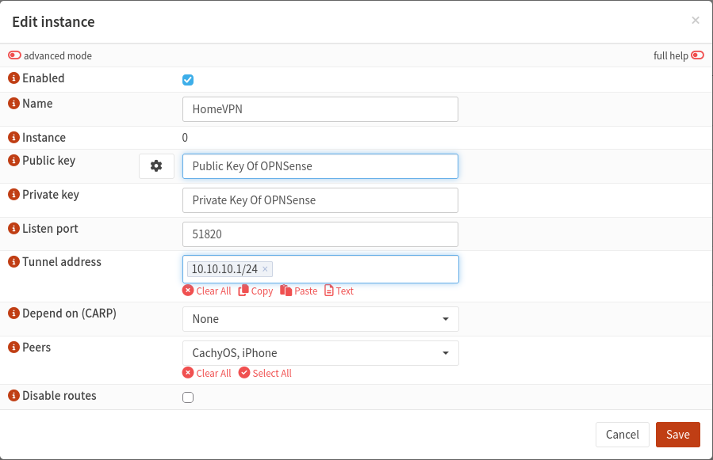
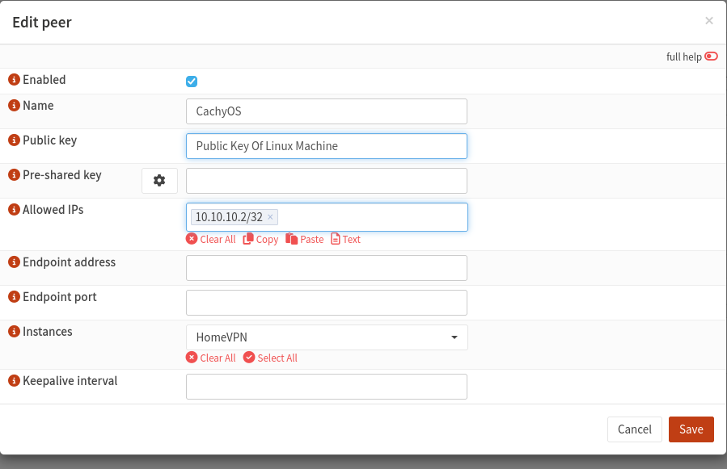

# 02 – OPNsense WireGuard Server Setup

## 1. Introduction

This section documents the configuration of a WireGuard VPN server on my OPNsense firewall.

The objective was to establish a secure VPN connection between my home network and a remote my Linux laptop, allowing both split-tunnel and full-tunnel connectivity.

## 2. WireGuard Server Configuration

WireGuard was configured through the OPNsense web interface.

Navigate to:

**VPN → WireGuard → Instances**


<table>
<tr>
<td valign="top">
<strong>WireGuard Instance Configuration</strong>
<table>
<tr><th>Setting</th><th>Configuration</th></tr>
<tr><td>Enabled</td><td>Yes</td></tr>
<tr><td>Name</td><td>HomeVPN</td></tr>
<tr><td>Listen Port</td><td>51820/UDP</td></tr>
<tr><td>Tunnel Address</td><td>10.10.10.1/24</td></tr>
<tr><td>Peers</td><td>CachyOS</td></tr>
<tr><td>Disable Routes</td><td>No</td></tr>
</table>
</td>
<td valign="top">

</td>
</tr>
</table>


The instance was saved and enabled.

The private key remains on the OPNsense firewall, while the public key is shared with the WireGuard client.

## 3. Creating the Linux Client Peer

Navigate to:

**VPN → WireGuard → Peers**

<table>
<tr>
<td valign="top">

<strong>Peer Configuration</strong>

<table>
<tr><th>Setting</th><th>Configuration</th></tr>
<tr><td>Enabled</td><td>Yes</td></tr>
<tr><td>Name</td><td>CachyOS</td></tr>
<tr><td>Public Key</td><td>Linux public key</td></tr>
<tr><td>Allowed IPs</td><td>10.10.10.2/32</td></tr>
<tr><td>Endpoint Address</td><td>Blank</td></tr>
<tr><td>Endpoint Port</td><td>Blank</td></tr>
<tr><td>Instance</td><td>HomeVPN</td></tr>
</table>

</td>
<td valign="top">



</td>
</tr>
</table>

The peer was associated with the HomeVPN instance.

This configuration allows OPNsense to identify the Linux laptop using its public key and assign it the VPN tunnel address `10.10.10.2`.

## 4. Configuring the WAN Firewall Rule

Navigate to:

**Firewall → Rules → WAN**

A firewall rule was configured to permit incoming WireGuard connections.

| Setting | Configuration |
|---|---|
| Action | Pass |
| Interface | WAN |
| Protocol | UDP |
| Source | Any |
| Destination | WAN address |
| Destination Port | 51820 |
| Description | Allow WireGuard VPN |

This permits incoming WireGuard traffic to reach the VPN server.

## 5. Configuring the HomeVPN Firewall Rules

Navigate to:

**Firewall → Rules → HomeVPN**

Firewall rules were configured to allow traffic originating from the Linux VPN client.

| Rule | Source | Destination | Protocol |
|---|---|---|---|
| Allow VPN Ping | 10.10.10.2/32 | 10.10.10.1 | ICMP |
| Allow VPN DNS | 10.10.10.2/32 | 10.10.10.1:53 | TCP/UDP |
| Allow Full Tunnel | 10.10.10.2/32 | Any | IPv4 Any |

These rules permit connectivity testing, DNS resolution, and forwarding of IPv4 internet traffic through OPNsense.

The full-tunnel rule also allows the VPN client to reach other internal IPv4 destinations. More restrictive rules can be used where network segmentation is required.

## 6. Configuring Outbound NAT

Navigate to:

**Firewall → NAT → Outbound**

Automatic outbound NAT rule generation was enabled.

The generated NAT rules included the HomeVPN network, allowing VPN client traffic to be translated to the WAN address when accessing the internet.

This was necessary for the full-tunnel configuration, where the Linux laptop sends internet-bound IPv4 traffic through OPNsense.

## 7. Configuring DNS

Navigate to:

**Services → Unbound DNS → General**

The following settings were verified:

| Setting | Configuration |
|---|---|
| Enable Unbound | Enabled |
| Listen Port | 53 |
| Network Interfaces | All |

An access list was created under:

**Services → Unbound DNS → Access Lists**

| Setting | Configuration |
|---|---|
| Name | WireGuard_VPN |
| Action | Allow |
| Network | 10.10.10.0/24 |

This permits DNS queries from authorized WireGuard clients.

A corresponding firewall rule was also required on the HomeVPN interface to permit DNS requests.

## 8. Verification

The WireGuard connection was verified from the Linux laptop using:

```bash
sudo wg show
```

A successful handshake confirmed that the WireGuard peers were communicating.

Connectivity to the OPNsense VPN interface was tested with:

```bash
ping -c 4 10.10.10.1
```

DNS resolution was tested using:

```bash
dig @10.10.10.1 google.com
```

Following firewall troubleshooting, both connectivity and DNS resolution worked successfully.

## 9. Security Considerations

- Each WireGuard peer uses its own public/private key pair.
- Private keys must not be published in screenshots or GitHub files.
- Incoming WireGuard traffic is restricted to UDP port 51820.
- Firewall rules can be restricted to individual VPN client addresses.
- The VPN does not require exposing the OPNsense web management interface directly to the internet.
- Any potentially disclosed private keys should be rotated before relying on the VPN for sensitive use.

## 10. Conclusion

The WireGuard server was successfully configured on OPNsense.

The server authenticated the CachyOS Linux client and provided the foundation for both split-tunnel remote access and full-tunnel IPv4 internet connectivity.

Further documentation covers the Linux client installation, routing configuration, troubleshooting, and testing.
