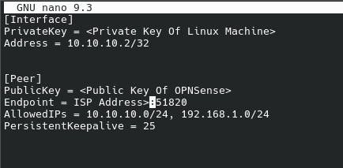

# 03 – WireGuard Linux Client Setup

## 1. Introduction

This section documents the installation and configuration of WireGuard on my CachyOS Linux laptop.

CachyOS is an Arch-based Linux distribution, so the `pacman` package manager was used to install WireGuard.

The laptop was configured as a WireGuard peer connecting to my OPNsense firewall, allowing secure remote access to my home network.

## 2. Installing WireGuard

First, update the system packages:

```bash
sudo pacman -Syu
```

Install WireGuard:

```bash
sudo pacman -S wireguard-tools
```

Verify the installation:

```bash
wg --version
```

The `wireguard-tools` package provides two important commands:

- `wg` – Displays and manages WireGuard interface information.
- `wg-quick` – Starts and stops WireGuard tunnels using configuration files.

## 3. Generating Public and Private Keys

WireGuard uses asymmetric cryptography, meaning each peer has its own public and private key pair.

Generate a key pair:

```bash
wg genkey | tee privatekey | wg pubkey > publickey
```

Secure the private key:

```bash
chmod 600 privatekey
```

Display the public key:

```bash
cat publickey
```

The public key was copied into the CachyOS peer configuration on OPNsense.

The private key remained on the Linux laptop.

**Security:** Never upload actual private keys to GitHub.

## 4. Creating the WireGuard Configuration

WireGuard configuration files are stored in:

```text
/etc/wireguard/
```

Create the directory if it does not already exist:

```bash
sudo mkdir -p /etc/wireguard
```

Open the configuration file:

```bash
sudo nano /etc/wireguard/wg0.conf
```

The following configuration was used for the split-tunnel connection:


```ini
[Interface]
PrivateKey = <CachyOS-private-key>
Address = 10.10.10.2/32

[Peer]
PublicKey = <OPNsense-public-key>
Endpoint = <home-public-IP>:51820
AllowedIPs = 10.10.10.0/24, 192.168.1.0/24
PersistentKeepalive = 25
```

### Configuration Explanation

| Setting | Purpose |
|---|---|
| PrivateKey | Identifies the CachyOS client using its private key |
| Address | Assigns the client its VPN tunnel address |
| PublicKey | Identifies the OPNsense VPN server |
| Endpoint | Specifies the home public IP address and WireGuard port |
| AllowedIPs | Defines which destination networks use the VPN |
| PersistentKeepalive | Helps maintain the connection through NAT |

The OPNsense public key was obtained from:

**VPN → WireGuard → Instances → HomeVPN**

The CachyOS private key was entered under `[Interface]`.

## 5. Securing the Configuration File

The configuration file contains the client's private key and must be protected.

Run:

```bash
sudo chmod 600 /etc/wireguard/wg0.conf
```

This restricts file access to the owner.

## 6. Starting WireGuard

Activate the VPN:

```bash
sudo wg-quick up wg0
```

Check the connection:

```bash
sudo wg show
```

A successful connection displays a recent handshake and traffic counters.

To stop the VPN:

```bash
sudo wg-quick down wg0
```

## 7. Testing Connectivity

Test connectivity to the OPNsense WireGuard address:

```bash
ping -c 4 10.10.10.1
```

Check the route to the home LAN:

```bash
ip route get 192.168.1.1
```

The expected route uses the `wg0` interface and the client's VPN address `10.10.10.2`.

Check the public IPv4 address:

```bash
curl -4 https://ifconfig.me
```

With split tunneling, ordinary internet traffic continues to use the client's current internet connection rather than the VPN.

## 8. Troubleshooting

During the initial setup, the VPN failed to establish a handshake.

The following command was used to investigate:

```bash
sudo wg show
```

The output showed transmitted packets but no successful handshake.

The issue was eventually traced to an incorrect public key in the CachyOS configuration.

The OPNsense private key had mistakenly been entered in the client's `[Peer] PublicKey` field.

After replacing it with the correct OPNsense instance public key, WireGuard successfully established a handshake.

Another issue occurred during local testing when traffic to `192.168.1.1` was routed through the WireGuard tunnel instead of the local Wi-Fi interface.

Routing was investigated using:

```bash
ip route get 192.168.1.1
```

The split-tunnel `AllowedIPs` setting was temporarily restricted to the WireGuard subnet to isolate the routing problem.

After the connection was working, the home LAN subnet was added back.

## 9. Conclusion

WireGuard was successfully installed and configured on CachyOS Linux.

The laptop established an encrypted VPN connection to the OPNsense firewall, allowing access to the home network from an external connection.

The next section documents the split-tunnel configuration in more detail.
