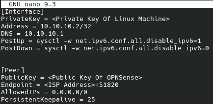
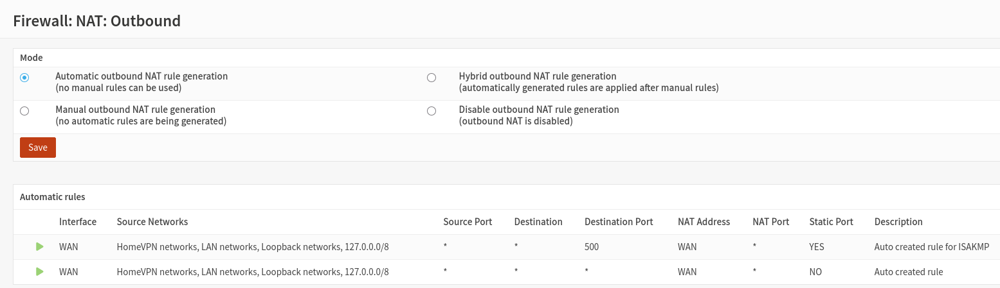
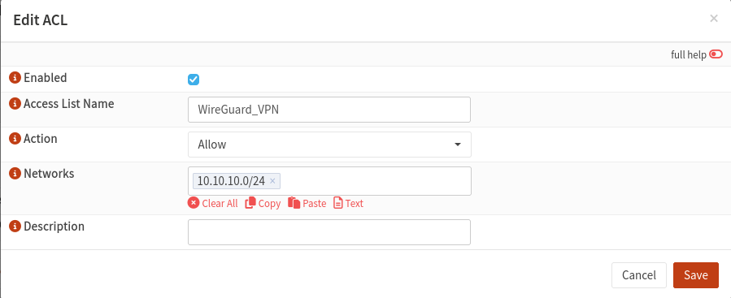

# 05 – Full-Tunnel Configuration

## 1. Overview

Full tunneling routes all IPv4 internet traffic through the WireGuard VPN instead of using the client's normal internet connection.

For this home lab, I configured a full-tunnel connection on my CachyOS laptop, allowing internet traffic to travel through the WireGuard tunnel to my home OPNsense firewall before being forwarded to the internet.

Unlike split tunneling, full tunneling allows me to use my home internet connection's public IPv4 address while connected to an external network.

## 2. Network Configuration

| Component | Address / Network |
|---|---|
| OPNsense LAN | `192.168.1.1/24` |
| Home LAN | `192.168.1.0/24` |
| WireGuard VPN | `10.10.10.0/24` |
| OPNsense WireGuard address | `10.10.10.1` |
| CachyOS client address | `10.10.10.2/32` |
| WireGuard listening port | `51820/UDP` |

## 3. Linux Full-Tunnel Configuration

I created a separate WireGuard configuration file to avoid modifying my working split-tunnel setup.

The full-tunnel configuration is stored at:

`/etc/wireguard/wg-full.conf`

The configuration uses `AllowedIPs = 0.0.0.0/0` to route all IPv4 traffic through WireGuard.

The `DNS` setting directs DNS queries to the OPNsense WireGuard address.

### Full-Tunnel Configuration Screenshot



### Important Configuration Settings

**AllowedIPs**

`AllowedIPs = 0.0.0.0/0`

This routes all IPv4 destinations through the VPN.

**DNS**

`DNS = 10.10.10.1`

This configures the client to use the OPNsense DNS resolver while the tunnel is active.

**PostUp and PostDown**

The configuration includes commands intended to disable IPv6 when the VPN starts and re-enable it when the VPN stops.

These were added because the tunnel only routes IPv4 traffic. Their effectiveness should be verified separately with IPv6 connectivity tests.

## 4. OPNsense Firewall Configuration

The OPNsense firewall must permit traffic arriving from the WireGuard client.

I configured firewall rules on the assigned HomeVPN interface to allow the client to communicate with the firewall and reach external networks.

### Firewall Rules

The rules included:

- ICMP access from `10.10.10.2` to `10.10.10.1` for connectivity testing.
- TCP/UDP DNS access from `10.10.10.2` to `10.10.10.1` on port `53`.
- IPv4 traffic from `10.10.10.2` to permitted destinations, including the internet.

### Firewall Screenshot


## 5. Outbound NAT Configuration

Outbound Network Address Translation (NAT) allows the WireGuard client's private IP address to be translated to the home connection's WAN address when accessing the internet.

In OPNsense, I used:

**Firewall → NAT → Outbound**

Outbound NAT was configured in Automatic mode, with a generated rule covering the WireGuard network.

### Outbound NAT Screenshot



## 6. DNS Configuration

I configured Unbound DNS on OPNsense to provide DNS resolution for the VPN client.

Under **Services → Unbound DNS → Access Lists**, I added an access list allowing the WireGuard network:

`10.10.10.0/24`

This allowed DNS queries from the VPN client to be processed by OPNsense.

The HomeVPN firewall interface also required a rule permitting DNS traffic to `10.10.10.1` on port `53`.

### DNS Configuration Screenshot



## 7. Starting the Full-Tunnel VPN

Before starting the full-tunnel connection, I disconnected the split-tunnel interface to avoid conflicting configurations.

```bash
sudo wg-quick down wg0
```

I then started the full-tunnel interface:

```bash
sudo wg-quick up wg-full
```

To verify the WireGuard connection:

```bash
sudo wg show
```

A recent handshake confirms communication between the CachyOS client and OPNsense server.

## 8. Testing the Full-Tunnel Connection

### Test 1 – VPN Connectivity

```bash
ping -c 4 10.10.10.1
```

This verifies connectivity to the OPNsense WireGuard interface.

### Test 2 – Internet Connectivity

```bash
ping -c 4 1.1.1.1
```

This checks whether IPv4 internet traffic can reach an external destination through the VPN.

### Test 3 – DNS Resolution

```bash
dig @10.10.10.1 google.com
```

This verifies that OPNsense can resolve DNS queries from the VPN client.

### Test 4 – Public IPv4 Address

```bash
curl -4 https://ifconfig.me
```

When connected to an external network, the public IPv4 address should match the home internet connection rather than the external network.

This confirms that IPv4 internet traffic is exiting through the home OPNsense firewall.

### Test 5 – Routing

```bash
ip -4 route
```

With `wg-quick`, full-tunnel routing may use policy routing and a separate routing table rather than replacing the default route in the main table.

The following commands provide additional evidence:

```bash
ip -4 rule show
sudo wg show
```

## 9. Disconnecting the VPN

To stop the full-tunnel connection:

```bash
sudo wg-quick down wg-full
```

This removes the full-tunnel interface and restores normal IPv4 routing.

## 10. Results

The full-tunnel configuration was successfully tested using the CachyOS laptop and OPNsense firewall.

The WireGuard connection established a successful handshake, internet connectivity worked, and DNS queries were resolved through the OPNsense DNS resolver.

Public IPv4 testing confirmed that internet traffic exited through the home connection rather than the external network.

This demonstrated how WireGuard can provide remote internet access through a self-hosted VPN gateway.
